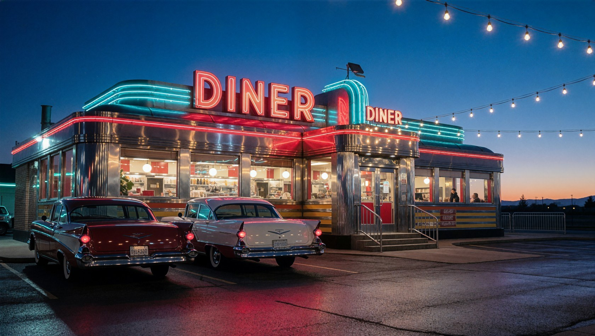
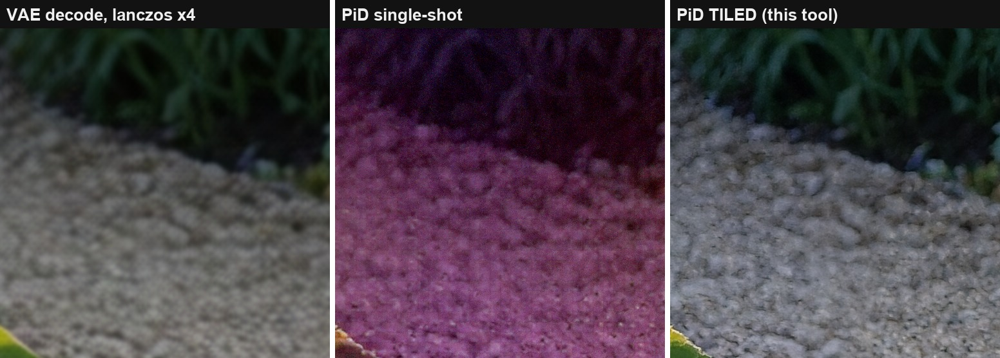
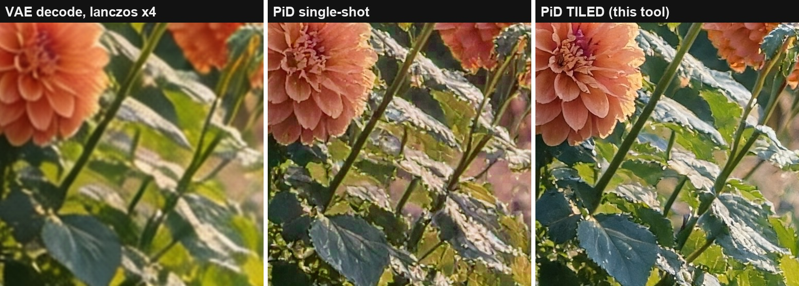

# pid-tiled-decode

**Latent-native tiled decoding for NVIDIA PiD — decode past the 4K envelope without the color collapse.**

[](https://github.com/BennyDaBall930/pid-tiled-decode/actions/workflows/selftest.yml)
[](LICENSE)


[PiD](https://research.nvidia.com/labs/sil/projects/pid/) (NVIDIA's Pixel Diffusion Decoder,
[arXiv:2605.23902](https://arxiv.org/abs/2605.23902)) decodes a diffusion latent **directly to a
4x-upscaled image** in 4 distilled steps — a 1024px-class latent becomes a 4096px-class image with
real generative detail, replacing the decode-then-upscale cascade.

But push a bigger latent through it single-shot and it falls off a cliff. The model's NTK-aware RoPE
was trained for the 1024→4096 envelope; at ~2x past that (a 2MP latent → 33MP output), the decode
doesn't just soften — **color collapses**: whites turn pink, midtones desaturate, chroma noise
everywhere.

This tool decodes the **same latent as overlapping tiles instead**. Every tile is a normal-sized PiD
job that stays inside the trained envelope, and the blend is seam-free. A 1920x1088 latent becomes a
clean **7680x4352 (33 MP) master in ~60 seconds** end-to-end on a single RTX 5090 — verified up to
**244MP** (15616x15616), scaling ~linearly at roughly 1MP of finished output per second.

> **Prefer nodes over scripts?** The same engine ships as native ComfyUI nodes (validated against
> this driver at 66 dB PSNR):
> **[ComfyUI-Latent-Tiled-PiD](https://github.com/BennyDaBall930/ComfyUI-Latent-Tiled-PiD)** —
> one node between KSampler and SaveImage, example workflow included.



## The problem, in one image

Same latent, same seed, decoded to 7680x4352 both ways. Left: the stage-1 VAE decode (lanczos-upscaled
for reference). Middle: single-shot PiD at 33 MP — magenta wash, chroma noise. Right: this tool.



That 100% crop sits **directly on the vertical tile seam** — find it. The second crop shows what the
decode adds over the plain VAE even before you care about size:



## Measured (reproducible demo, prompt + seed below)

| decode @ 33 MP | midtone chroma Δ vs VAE twin | shadow green-bias Δ | verdict |
|---|---|---|---|
| single-shot PiD | **30.3** (flag > 20) | -4.51 | collapsed |
| **tiled (this tool)** | **12.7** | +2.44 | clean |

Seam QA on the same run: worst seam gradient ratio **1.04** (1.0 = statistically invisible,
flag > 1.15); tile overlap agreement 22.7–26.4 dB PSNR. At production resolution (1344x768 → 5376x3072,
inside the envelope) tiled decoding is quality-parity with single-shot and tracks the VAE twin's color
*tighter* (green-bias Δ +1.0 vs +5.7 on our test scene).

Every run emits the receipts: `review.html` with 100%-crop A/B strips at every seam and junction, a
tile contact sheet, a seam map, and `qa.json`/`qa.md` with all metrics.

## Why latent-native tiling matters

Existing tiled-PiD flows (see [prior art](#prior-art--credits)) tile the **decoded image** and
VAE-re-encode each tile before running PiD — a lossy round-trip through a decode that already
happened, run on tiles that were never real latents. This tool crops the **actual sampled latent**
PiD was designed to condition on:

- **No VAE re-encode round-trip.** The latent PiD sees per tile is bit-identical to the corresponding
  region of the generation latent.
- **RoPE needs no position hacks.** PiD's rotary embeddings are relative; a tile decoded as its own
  image is indistinguishable from a native render of that size — which is the entire point: every
  tile runs in the regime the checkpoint was trained and distilled for.
- **Tiles can't drift apart.** PiD's sigma-gated LQ injection anchors every other transformer block
  to the latent crop, so structure is pinned; only micro-texture varies per tile, and the
  complementary raised-cosine feather (weights sum to exactly 1) absorbs it.
- **Uniform exact-coverage planner.** All tiles are the same size, positions snap to the latent grid
  (8 px) so every tile is latent-exact — no interpolation shifts.

## Quickstart

Requirements: a running ComfyUI server (≥ 0.28, PiD support is in core) with the PiD checkpoints
(`pid_1.5_qwenimage_1024_to_4096_4step_bf16.safetensors` + `gemma_2_2b_it_elm_bf16.safetensors` —
use v1.5, v1 is deprecated upstream and measurably worse on color — NVIDIA
weights under the [NVIDIA License](https://huggingface.co/nvidia/PixelDiT-1300M-1024px/blob/main/LICENSE),
non-commercial research/evaluation use), and any python with `numpy` + `pillow` (the ComfyUI venv
works). No custom nodes.

**Universal flow — decode a latent from *your own* workflow:** add a `SaveLatent` node after your
KSampler, run your workflow once, then:

```bash
python pid_tiled_decode.py --from-latent "latents/my_shot_00001_.latent" \
    --label my_shot_8k --out runs/my_shot_8k \
    --vae-image path/to/your_vae_decode.png   # optional: enables VAE-twin QA + A/B strips
```

**Or let the tool run stage-1 too** (qwen-family example; swap in your models):

```bash
python pid_tiled_decode.py \
    --prompt "1950s American roadside diner at blue-hour dusk, gleaming stainless-steel streamliner exterior with a red neon sign that reads DINER, chrome trim and big glass windows glowing warm from inside, two parked classic cars with chrome tailfins and whitewall tires, strings of warm bulb lights over the empty forecourt, wet asphalt with neon reflections, deep blue sky fading to orange at the horizon, cherry-red and turquoise palette, crisp photographic detail" \
    --unet-name krea2_turbo_fp8_scaled.safetensors \
    --clip-name qwen3vl_4b_fp8_scaled.safetensors --clip-type krea2 \
    --label demo_diner --out runs/demo_diner \
    --width 1920 --height 1088 --seed 508040200 --full-frame
```

That exact command (with `--full-frame` for the single-shot A/B) produced the measured numbers in
this README. The photos come from an identical run with a different prompt ("beautiful flower garden
in full summer bloom, ...", seed `508040300`) — same pipeline, same settings, same everything else.

Point the tool at your install with `--comfy-url` / `--comfy-root` or the `COMFYUI_URL` /
`COMFYUI_ROOT` env vars. Offline sanity check: `python pid_tiled_decode.py --self-test`.

### Key flags

| flag | default | meaning |
|---|---|---|
| `--max-tile` | 1024 | max tile size per axis in stage-1 px (1024 = PiD's trained envelope) |
| `--overlap` | 64 | tile overlap in stage-1 px (x4 in output; feather band) |
| `--full-frame` | off | also run the single-shot decode for A/B (expect collapse past ~4K output) |
| `--from-latent` | — | reuse a saved latent; re-tile without re-rendering stage-1 |
| `--latent-format` | qwenimage | `flux` / `sd3` / `sdxl` / `qwenimage` (matches PiDConditioning) |
| `--degrade-sigma` | 0.0 | PiD's noisy-latent conditioning knob for partially-denoised latents |

## Warning: core `LatentCrop` silently corrupts qwen-family latents

Found while building this. ComfyUI's core `LatentCrop` indexes latents as `[B, C, H, W]`, but
qwen-image / Wan-family latents are **5-dim** `[B, C, T, H, W]` — so it crops T/H while thinking
they're H/W. You get a horizontal band of the wrong region, stretched, with no error raised.
This tool slices latents itself (`crop_latent_tensor`, last-two-dims, rank-agnostic). Full writeup +
one-line core fix: [docs/comfyui-latentcrop-5dim-bug.md](docs/comfyui-latentcrop-5dim-bug.md).

## QA gates (calibrated on real decodes)

- **Midtone chroma delta vs VAE twin** — catches the past-envelope collapse (healthy: 10–15, broken:
  ~30; flag > 20). A shadow-only green metric *misses* this failure mode: the collapse lives in the
  midtones, and the broken 33 MP decode scored "in gate" on shadow green-bias alone.
- **Shadow green-bias delta** (flag ± 3) — catches the milder tone drift that appears first near the
  envelope edge.
- **Seam gradient ratio** per seam (flag > 1.15) and **overlap-agreement PSNR** per tile pair.

## Prior art & credits

- [nv-tlabs/PiD](https://github.com/nv-tlabs/PiD) — the model and
  [tech report](https://arxiv.org/abs/2605.23902) (Lu, Wu, Wu, Wang, Ling, Fidler, Ren; NVIDIA). All
  credit for PiD itself.
- [Merserk/ComfyUI-PiD](https://github.com/Merserk/ComfyUI-PiD) — node pack with an **image-space**
  tiled PiD upscaler (tiles the decoded image, VAE-encodes each tile, runs PiD per tile). Different
  design point: great for upscaling arbitrary images; this repo instead tiles the *generation latent
  itself* for decode-faithful high-res output, and adds the envelope-collapse measurements and QA
  gates.
- [tsolful/ComfyUI-PiD](https://github.com/tsolful/ComfyUI-PiD) — PiD nodes (no tiling).
- To our knowledge, latent-native tiled PiD decoding, the measured characterization of the
  past-envelope color collapse, and the `LatentCrop` 5-dim bug are first published here (2026-08-04).
  If someone beat us to any of it, open an issue and we'll link them.

```bibtex
@article{lu2026pid,
  title={PiD: Fast and High-Resolution Latent Decoding with Pixel Diffusion},
  author={Lu, Yifan and Wu, Qi and Wu, Jay Zhangjie and Wang, Zian and Ling, Huan and Fidler, Sanja and Ren, Xuanchi},
  journal={arXiv preprint arXiv:2605.23902},
  year={2026}
}
```

## License & compliance

- Everything **in this repo** — code, docs, demo images (our own generations) — is MIT.
- This repo contains **no NVIDIA model weights and no NVIDIA code**. The PiD checkpoints are
  NVIDIA's, distributed by NVIDIA under the
  [NVIDIA License](https://huggingface.co/nvidia/PixelDiT-1300M-1024px/blob/main/LICENSE)
  (non-commercial: research and evaluation use) — get them from the official release channels and
  read that license before using the model in anything commercial.
- This is an independent project: not affiliated with, sponsored by, or endorsed by NVIDIA or
  Comfy Org. "PiD" and "PixelDiT" are used to describe compatibility, nothing more.

**Follow me on X [@BennyDaBall_OG](https://x.com/BennyDaBall_OG) !**

**Want to support my work? Buy me a coffee on [Ko-fi](https://ko-fi.com/bennydaball) !**
